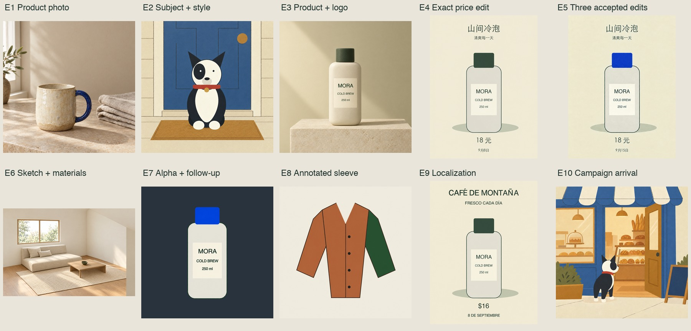
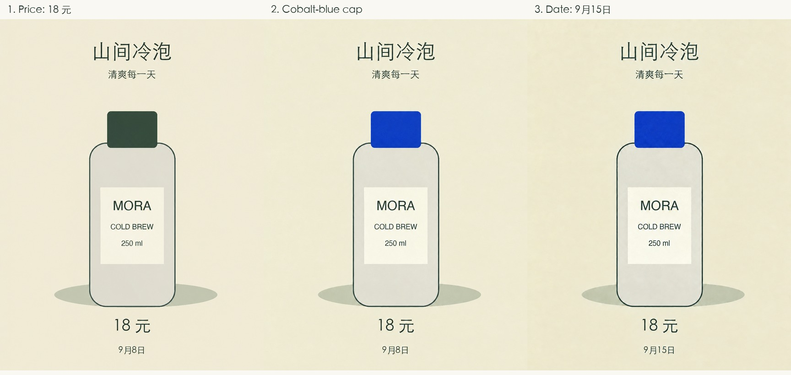
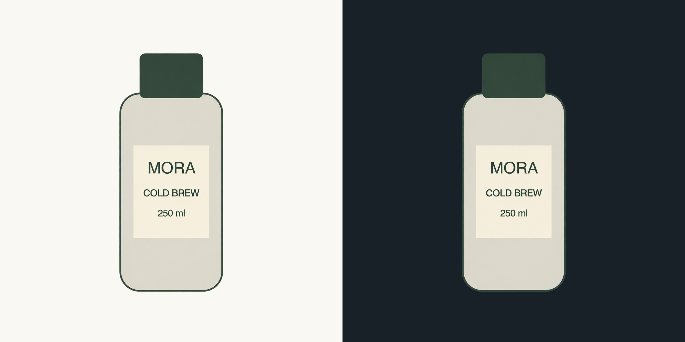
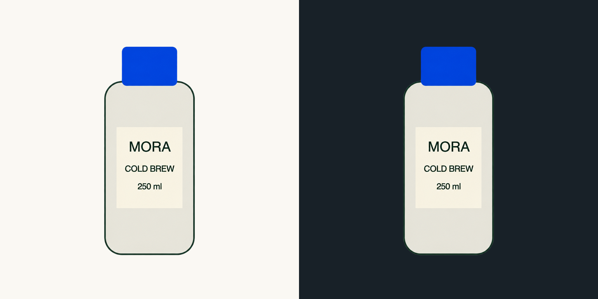

# Live GPT Image 2.5 results

**2026-09-08: 22 of 22 requests completed successfully through the canonical CLI and real OpenAI API.** These include 21 GPT Image 2.5 requests and one explicit Image 2 baseline. The ten feature recipes have rendered, visually inspected results. One campaign output needed a focused corrective edit; the original and correction are both retained.

The contact sheet is a resized, labeled preview; the transparent asset is composited on a dark background for visibility. The original PNG responses are retained byte-for-byte. [Portable input provenance](../../../skills/gpt-image/assets/gpt-image-2-5/README.md) identifies the original deterministic drawings used as references.

## What the live tests established

| Capability | Observed result |
|---|---|
| Default generation | Flare generated the mug photo in 19.29 seconds with the requested subject, texture, light and composition |
| Reference roles | Dog/style and bottle/style/wordmark compositions retained recognizable subjects and excluded unrelated style-source content |
| Precise and successive edits | Correct Chinese price, cap recolor and date; all earlier accepted changes survived the three-edit chain |
| Sketch, alpha and localized edits | Layout/material roles worked; cutout retained real alpha through an edit; annotation and mask both changed the intended sleeve |
| Copy and series | Spanish strings and process labels were correct; campaign identity needed one focused correction for an added flank marking |

## Visual limits observed

**Preservation was not pixel-exact.** The price and sleeve edits added slight texture/shading outside the target. Localization increased the headline font weight. The interior rendering kept the layout relationships but introduced pillows and a rug. These are useful outputs for the stated concepts; strict pixel, typography or architectural requirements need additional constraints or deterministic editing.

**Transparent cutouts were fractionally translucent throughout.** Both alpha outputs span 0–254, with no fully opaque 255 pixels. Light/dark previews show usable edges, but workflows requiring a fully opaque product interior should inspect the alpha values and make a deliberate alpha/compositing correction. Neither the original output nor its provenance was overwritten.

**One added identity detail was corrected.** The first [arrival scene](e10-arrival.png) added a round white patch to the dog's hindquarter. A focused edit using the original identity anchor [removed it](e10-arrival-corrected.png). The [purchase scene](e10-purchase.png) retained the intended markings. This is why the skill calls for inspecting identity and preserving accepted changes.

## Requests, timings and usage

Each JSON record contains the exact prompt/CLI arguments, ordered input paths and hashes, requested model/controls, UTC timestamps, returned usage, request ID, output hash and visual findings. The Images responses did not return a dated model snapshot; the recorded alias is the model requested. Every case has one application-level attempt; automatic SDK retries were not separately instrumented. The corrective campaign edit is a separate recorded request.

| Output and record | Model / quality | Seconds | Input / output tokens | Rate estimate | Visual assessment |
|---|---|---:|---:|---:|---|
| [e1-mug](e1-mug.png) · [record](e1-mug.json) | 2.5-flare / high | 19.29 | 68 / 1756 | $0.0530 | accepted |
| [e4-price-flare-high](e4-price-flare-high.png) · [record](e4-price-flare-high.json) | 2.5-flare / high | 14.49 | 1510 / 1629 | $0.0608 | accepted with caveat |
| [e2-dog-at-door](e2-dog-at-door.png) · [record](e2-dog-at-door.json) | 2.5-flare / high | 17.70 | 2157 / 1756 | $0.0696 | accepted |
| [e7-cutout](e7-cutout.png) · [record](e7-cutout.json) | 2.5-flare / high | 15.96 | 1088 / 1756 | $0.0612 | accepted with caveat |
| [e3-bottle-campaign](e3-bottle-campaign.png) · [record](e3-bottle-campaign.json) | 2.5-flare / high | 21.43 | 3217 / 1756 | $0.0780 | accepted |
| [e5-blue-cap](e5-blue-cap.png) · [record](e5-blue-cap.json) | 2.5-flare / high | 16.66 | 1506 / 1629 | $0.0608 | accepted |
| [e6-room](e6-room.png) · [record](e6-room.json) | 2.5-flare / high | 17.85 | 2690 / 1372 | $0.0623 | accepted with caveat |
| [e8-mask](e8-mask.png) · [record](e8-mask.json) | 2.5-flare / high | 17.28 | 1064 / 1756 | $0.0611 | accepted with caveat |
| [e7-cutout-blue](e7-cutout-blue.png) · [record](e7-cutout-blue.json) | 2.5-flare / high | 17.35 | 1066 / 1756 | $0.0611 | accepted with caveat |
| [price-sunburst-high](price-sunburst-high.png) · [record](price-sunburst-high.json) | 2.5-sunburst / high | 22.00 | 1510 / 1629 | $0.0608 | accepted with caveat |
| [price-flare-xhigh](price-flare-xhigh.png) · [record](price-flare-xhigh.json) | 2.5-flare / xhigh | 16.57 | 1510 / 2895 | $0.0988 | accepted with caveat |
| [e5-new-date](e5-new-date.png) · [record](e5-new-date.json) | 2.5-flare / high | 18.06 | 1506 / 1629 | $0.0608 | accepted with caveat |
| [price-flare-max](price-flare-max.png) · [record](price-flare-max.json) | 2.5-flare / max | 34.34 | 1510 / 6514 | $0.2073 | accepted with caveat |
| [e9-spanish-poster](e9-spanish-poster.png) · [record](e9-spanish-poster.json) | 2.5-flare / high | 16.43 | 1576 / 1629 | $0.0611 | accepted with caveat |
| [price-sunburst-xhigh](price-sunburst-xhigh.png) · [record](price-sunburst-xhigh.json) | 2.5-sunburst / xhigh | 29.29 | 1510 / 2895 | $0.0988 | accepted with caveat |
| [price-sunburst-max](price-sunburst-max.png) · [record](price-sunburst-max.json) | 2.5-sunburst / max | 49.53 | 1510 / 6514 | $0.2073 | accepted with caveat |
| [e8-annotation](e8-annotation.png) · [record](e8-annotation.json) | 2.5-flare / high | 15.21 | 2126 / 1756 | $0.0695 | accepted with caveat |
| [e10-arrival](e10-arrival.png) · [record](e10-arrival.json) | 2.5-flare / high | 19.22 | 2156 / 1756 | $0.0696 | needs correction |
| [price-image2-high](price-image2-high.png) · [record](price-image2-high.json) | 2 / high | 83.12 | 1500 / 6514 | Not estimated | accepted with caveat |
| [layout-check](layout-check.png) · [record](layout-check.json) | 2.5-flare / high | 13.81 | 71 / 1372 | $0.0415 | accepted |
| [e10-purchase](e10-purchase.png) · [record](e10-purchase.json) | 2.5-flare / high | 36.87 | 2162 / 1756 | $0.0696 | accepted |
| [e10-arrival-corrected](e10-arrival-corrected.png) · [record](e10-arrival-corrected.json) | 2.5-flare / high | 24.27 | 2166 / 1756 | $0.0697 | accepted |

**Estimated 2.5 usage cost: $1.6824**, including the campaign correction and every 2.5 comparison. This is an uncached-rate calculation using returned text/image usage and the [dated standard prices](../../../skills/gpt-image/references/model-api.md#pricing-and-sdk-compatibility), not an invoice. It excludes the Image 2 baseline and does not assert whether cached discounts or account-specific adjustments applied.

## Controlled comparison

The price-edit comparisons all use the same original 1152×1536 input, exact prompt, PNG output and omitted edit moderation/fidelity. Only model and explicitly stated quality vary. Every variant correctly rendered “18 元” and retained the other copy. Flare high was sufficient for this brief; xhigh/max did not resolve an unmet requirement here and consumed more output tokens.

The JSON records also report mean absolute RGB difference outside a fixed price region. This is a descriptive pixel-change measure, not a semantic quality score. Timings are single observations, with some independent calls overlapping; they are not a throughput study or a general model ranking. The Image 2 baseline took 83.12 seconds, Flare high 14.49 seconds, and Sunburst high 22.00 seconds in this sample.

## Reproduce

From the repository root, use the exact `argv` in a case's JSON record with the packaged `gpt-image` command. Configure credentials through the documented environment/dotenv mechanism. Inputs and outputs are repository-relative; use a new output filename to retain the recorded result. Follow-up cases require the earlier accepted outputs. The temporary measurement driver called the canonical CLI; no second API implementation was added to the skill.

These live checks cover PNG generation/editing and the controls shown. JPEG/WebP encoding, explicit edit moderation, optional fidelity and stale-backend handling also have offline regression coverage; they were not all separately exercised against the live API. No model result is guaranteed across new requests or future alias updates.
